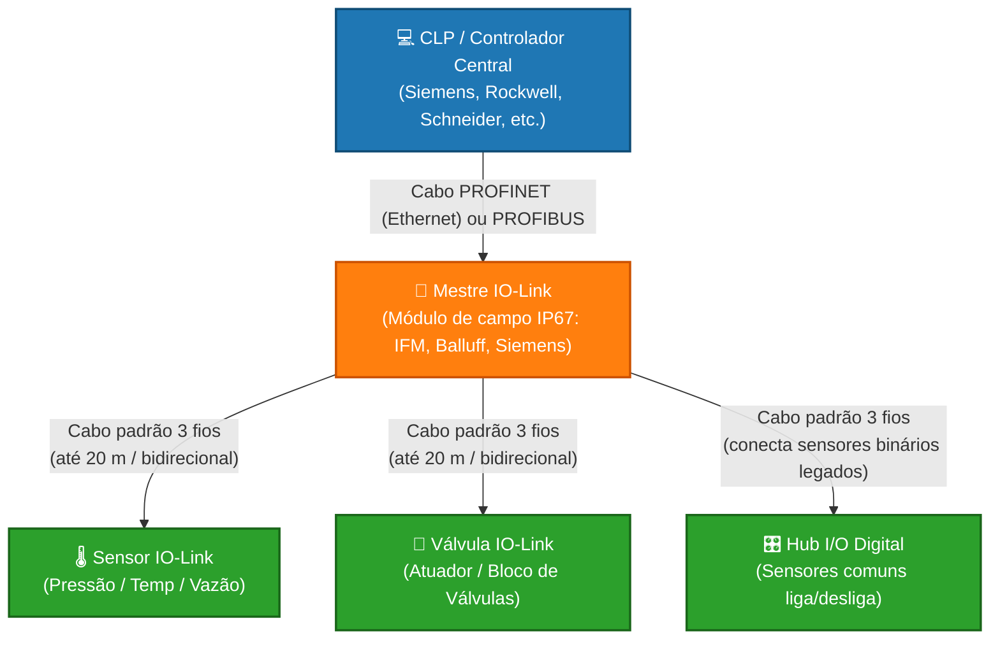
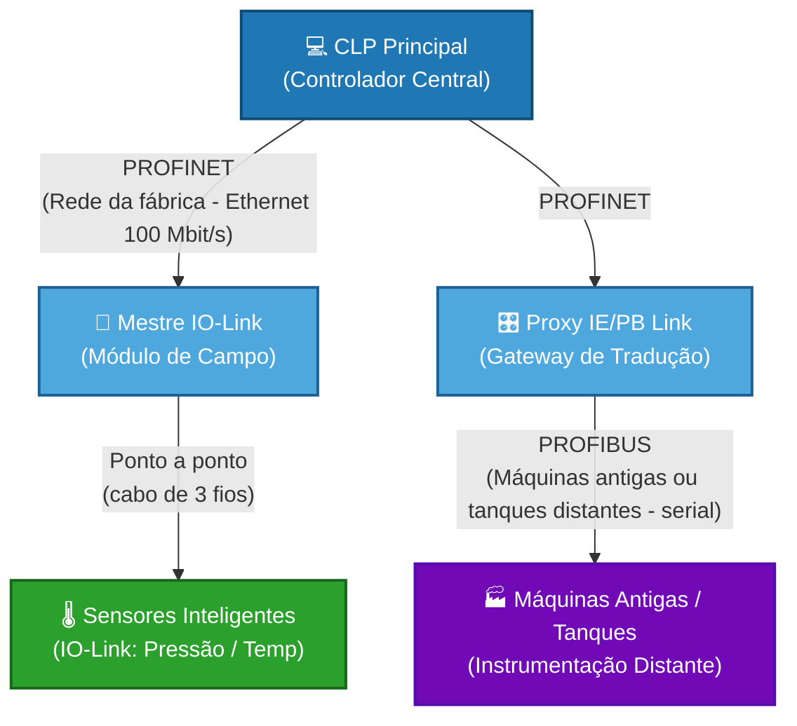

# PROFINET, PROFIBUS e IO-Link

## 1 - Caracterização do protocolo: frequência de trabalho, acesso ao meio (colisão), aplicação/uso

### 1.1 Visão geral

PROFINET, PROFIBUS e IO-Link não competem entre si: cada um atua em um nível diferente da pirâmide de automação e eles trabalham juntos para conectar a sala de controle ao sensor mais simples na ponta do processo.

- **PROFINET (rede principal, Ethernet):** Ethernet industrial de alta velocidade (≥ 100 Mbit/s). Conecta os controladores (CLPs) aos módulos de campo, inversores de frequência e mestres IO-Link.
- **PROFIBUS (rede de campo legada, serial):** antecessor do PROFINET, baseado em comunicação serial RS-485. Está sendo substituído pelo PROFINET em instalações novas, mas continua muito presente e é integrado às redes modernas por gateways ou proxies (como o IE/PB Link da Siemens).
- **IO-Link (nível de dispositivo, ponta):** não é um barramento (fieldbus), e sim uma conexão **ponto a ponto** padronizada (IEC 61131-9), de curto alcance (até 20 m). Transforma sensores e atuadores comuns em dispositivos "inteligentes", enviando dados de processo, diagnóstico, temperatura e parametrização por um cabo comum de 3 fios, não blindado.

**Comparativo rápido**

| | PROFINET | PROFIBUS | IO-Link |
|---|---|---|---|
| Tipo | Ethernet industrial | Fieldbus serial (RS-485) | Ponto a ponto (IEC 61131-9) |
| Papel | Rede principal da fábrica | Rede de campo (legado) | Última milha: sensor/atuador |
| Velocidade | 100 Mbit/s (até 1 Gbit/s) | 9,6 kbit/s a 12 Mbit/s | 4,8 / 38,4 / 230,4 kbit/s |
| Acesso ao meio | Full-duplex comutado (sem colisão) | Mestre/escravo + token | Mestre/escravo ponto a ponto |
| Alcance típico | 100 m por segmento de cobre | 100 m a 1200 m (depende da velocidade) | 20 m |



---

### 1.2 Frequência de trabalho

Em cada protocolo, "frequência de trabalho" significa algo um pouco diferente.

#### PROFIBUS (DP): Baud Rate

É a velocidade física com que os pulsos elétricos trafegam pelo cabo (cabo roxo no DP).

- Velocidades configuráveis: de **9,6 kbit/s até 12 Mbit/s**.
- **Detalhe importante:** quanto maior a velocidade, **menor** o comprimento máximo do cabo por segmento.

| Velocidade | Comprimento máx. por segmento |
|---|---|
| 9,6 a 93,75 kbit/s | 1200 m |
| 187,5 kbit/s | 1000 m |
| 500 kbit/s | 400 m |
| 1,5 Mbit/s | 200 m |
| 3 a 12 Mbit/s | 100 m |

#### PROFINET: velocidade fixa + tempo de ciclo

Como roda sobre Ethernet industrial, a velocidade física é padrão: **100 Mbit/s** (ou 1 Gbit/s em redes de alta performance).

Por isso, nos manuais, "frequência de trabalho" no PROFINET normalmente se refere à **frequência de atualização** (*Send Clock* / *Update Time*): o intervalo em que o CLP envia e recebe os dados de cada dispositivo.

- **PROFINET RT:** ciclos da ordem de milissegundos (por exemplo, 1 ms, 2 ms).
- **PROFINET IRT:** ciclos em microssegundos, chegando a 250 µs ou menos em aplicações de movimento sincronizado.

#### IO-Link: canais COM

Aqui o termo indica a **taxa de transmissão** entre mestre e sensor. O padrão define três velocidades (canais COM):

| Canal | Velocidade | Tempo mínimo de ciclo (aprox.) | Uso típico |
|---|---|---|---|
| COM1 | 4,8 kbit/s | ~18 ms | Dispositivos simples, com poucos dados |
| COM2 | 38,4 kbit/s | ~2,3 ms | Sensores de pressão e temperatura |
| COM3 | 230,4 kbit/s | ~0,4 ms | Dispositivos com muitos dados (leitores de código, sensores de vazão complexos) |

**O que isso muda na prática:** quanto maior a velocidade, mais rápido o CLP recebe as atualizações do sensor. Cada dispositivo trabalha em uma dessas velocidades e o mestre IO-Link a identifica automaticamente na conexão.

---

### 1.3 Acesso ao meio (colisão)

#### PROFIBUS: mestre/escravo + token passing (híbrido)

Baseado em RS-485, combina dois métodos:

- **Mestre/escravo:** o mestre (CLP) comanda a rede. O escravo (por exemplo, uma remota de I/O) nunca fala por iniciativa própria: espera ser consultado, responde e volta a ficar em silêncio.
- **Passagem de bastão (token passing):** se houver mais de um mestre (por exemplo, dois CLPs ou um CLP e uma IHM), eles passam entre si uma mensagem especial chamada **token**. Quem possui o token controla a rede e conversa com seus escravos por um tempo determinado; depois passa o token ao próximo mestre.

Como só quem tem o token transmite, **não há colisão**.

#### PROFINET: full-duplex e comutação por switches (sem colisão)

O PROFINET abandonou a disputa pelo cabo do Ethernet antigo (CSMA/CD).

- **Full-duplex dedicado:** cada dispositivo tem um canal exclusivo para enviar e outro para receber ao mesmo tempo, ligado a **switches industriais**. Sem meio compartilhado, não existe colisão.
- **Classes de tráfego:** o acesso é organizado por prioridades.
  - **PROFINET RT (Real-Time):** não usa as camadas TCP/IP. Os dados vão em quadros Ethernet diretamente, com prioridade no switch.
  - **PROFINET IRT (Isochronous Real-Time):** divide o tempo da rede em **janelas** rígidas. Uma janela é reservada aos dados críticos de sincronismo e movimento (como motores) e outra fica livre para dados comuns (páginas web, diagnósticos de TI).

#### IO-Link: mestre/escravo puro (ponto a ponto)

É o acesso mais simples e robusto.

- **Ponto a ponto exclusivo:** cada porta do mestre tem um único cabo ligado a um único sensor.
- **Mestre/escravo estrito:** o mestre dita o ritmo (ciclo). Ele envia uma solicitação e o sensor responde no tempo alocado. Como é uma linha privada entre os dois, o risco de colisão é **zero**.

---

### 1.4 Aplicações e uso

#### PROFINET + IO-Link (padrão moderno)

Combinação ideal para indústrias que exigem alta velocidade, flexibilidade, setup rápido e diagnóstico preciso.

- **Indústria automotiva e linhas de montagem**
  - *Uso:* robôs de solda e braços mecânicos. O PROFINET (IRT) gerencia os servomotores em alta velocidade. Na ponta do robô, as garras usam mestres IO-Link para coletar dados de sensores de presença, pressão de ar e atuadores.
  - *Vantagem:* se um sensor quebra, basta trocar a peça. O mestre IO-Link restaura automaticamente a configuração anterior no sensor novo (função *Data Storage*), sem computador.
- **Máquinas de embalagem e rotuladoras (alimentos e bebidas)**
  - *Uso:* sensores ópticos IO-Link detectam garrafas ou caixas em esteiras rápidas.
  - *Vantagem:* ao trocar o produto da linha (por exemplo, garrafa de 350 ml para 2 litros), o CLP envia uma "receita" via PROFINET ao mestre IO-Link, que reconfigura sensibilidade e distância de todos os sensores automaticamente, sem ajuste manual no chão de fábrica.

#### PROFIBUS (legados e grandes distâncias)

Apesar de o PROFINET dominar as fábricas novas, o PROFIBUS (versões DP e PA) continua muito usado.

- **Saneamento, tratamento de água e indústria química (PROFIBUS PA)**
  - *Uso:* controle de tanques, bombas e válvulas espalhados por grandes distâncias (mais de 1 km por segmento), com um único par de fios.
  - *Zonas explosivas:* o PROFIBUS PA limita a energia elétrica no cabo (segurança intrínseca), evitando que uma faísca cause explosão em refinarias ou silos de grãos. Nessas áreas, o cabo costuma ser azul.
- **Retrofit de plantas antigas (PROFIBUS DP)**
  - *Uso:* fábricas construídas entre as décadas de 1990 e 2010 têm redes PROFIBUS funcionando bem. Nelas, o protocolo segue em uso para manutenção e pequenas expansões.

#### Uso misto (as três tecnologias juntas)

Em plantas grandes (siderúrgicas, fábricas de celulose), é comum ver as três tecnologias integradas por **gateways/proxies**.



**Como funciona:** o núcleo da fábrica roda em PROFINET. Para falar com um setor antigo ou com instrumentos de processo distantes, o sinal passa por um módulo acoplador (como o IE/PB Link da Siemens), que traduz PROFINET para PROFIBUS, sem que o CLP perca o controle.

---

## 2 - Relação com a pirâmide de automação e indústria 4.0


A pirâmide de automação (ISA-95) tem 5 níveis, e cada protocolo ocupa uma faixa diferente dela:

Pirâmide x protocolos

    Nível 0 (processo/campo físico): sensores e atuadores. O IO-Link vive aqui, na última milha, entre o dispositivo e o mestre.
    Nível 1 (controle): CLPs, drives. O PROFIBUS (DP/PA) e o PROFINET IO conectam o CLP aos dispositivos de campo.
    Nível 2 (supervisão): SCADA/IHM. O PROFINET (Ethernet) também atua aqui, junto com OPC UA.
    Nível 3 (MES): gestão da produção.
    Nível 4 (ERP): gestão corporativa.

Cada protocolo

    IO-Link: comunicação ponto a ponto (cabo de 3 ou 5 fios, até 20 m) entre sensor/atuador e um mestre IO-Link. Não é um barramento. O mestre se liga ao CLP por PROFINET, PROFIBUS ou outro fieldbus. Traz diagnóstico, parametrização remota e troca de dispositivo sem reconfigurar.
    PROFIBUS: fieldbus serial (RS-485) tradicional, determinístico, ainda muito presente em plantas legadas. Atende o nível 1 e o campo. É limitado em velocidade (até 12 Mbit/s) e em dados de diagnóstico.
    PROFINET: baseado em Ethernet industrial. Sobe da camada de campo até a de supervisão, com tempo real (RT/IRT) e TCP/IP no mesmo cabo. É o sucessor natural do PROFIBUS.

Relação com a Indústria 4.0

A Indústria 4.0 pede que a pirâmide deixe de ser rígida, com dados fluindo do sensor até a nuvem sem passar por todas as camadas. Cada protocolo contribui de forma diferente:

    IO-Link: é a “porta de entrada” dos dados. Traz do chão de fábrica não só o sinal de processo, mas também diagnóstico, temperatura interna, horas de operação, alarmes de manutenção preditiva. Leva inteligência a sensores simples.
    PROFINET: é a espinha dorsal. Por ser Ethernet, integra OT e TI, convive com OPC UA, MQTT e comunicação com MES/ERP/nuvem, e permite diagnóstico de rede avançado (topologia, SNMP).
    PROFIBUS: é o ponto fraco. Não foi pensado para conectividade com TI. Em plantas legadas, usa-se gateways PROFIBUS-PROFINET para modernizar sem trocar tudo.

Arquitetura típica moderna

Sensor (IO-Link) → Mestre IO-Link → CLP (PROFINET) → Gateway/edge (OPC UA/MQTT) → MES/ERP/nuvem

Quer que eu monte um diagrama visual dessa arquitetura?

pd escrever md em uma maneira de facientendimenet
Created a file, shared a file

Pronto, o arquivo automacao_profinet_profibus_iolink.md está acima. Usei tabelas, listas curtas e um esquema de arquitetura para facilitar a leitura.

Se quiser, posso deixar o texto mais curto, como uma cola de estudo, ou converter para PDF ou Word.
Automacao profinet profibus iolink
Document·MD 
Pasted text.txt
Pasted text.txt
TXT

esse text  pd mehrar pra mim
Created a file, shared a file

Revisei o texto e o novo arquivo é o profinet_profibus_iolink_melhorado.md. Mantive sua estrutura e as seções 2 a 7 ficaram como espaços “a preencher”.

O que melhorei

    Organizei a seção 1 em quatro partes: visão geral, frequência de trabalho, acesso ao meio e aplicações.
    Acrescentei uma tabela comparativa dos três protocolos no início.
    Acrescentei uma tabela de velocidade x comprimento de cabo do PROFIBUS e uma tabela dos canais COM do IO-Link com o tempo de ciclo de cada um.
    Padronizei o texto e removi trechos repetidos.

O que corrigi tecnicamente

    Diagrama do uso misto: a ligação CLP → IE/PB Link estava como “Barramento Local”. Ela é feita por PROFINET, porque o IE/PB Link fica na rede Ethernet e traduz para PROFIBUS do outro lado.
    PROFINET RT: ele não vai “da camada de aplicação direto para a física”. Usa quadros Ethernet diretamente, sem TCP/IP, com prioridade no switch.
    Token: é uma mensagem especial na rede, não um “arquivo virtual”.
    IO-Link: cada dispositivo trabalha em uma única velocidade COM e o mestre a identifica. Não é o mestre que “ajusta” a frequência. Também citei o recurso Data Storage, que explica a troca de sensor sem computador.
    PROFIBUS PA: o cabo costuma ser azul (o roxo é do DP) e a segurança intrínseca fica mais clara.

Os tempos de ciclo do IO-Link (~18 ms, ~2,3 ms, ~0,4 ms) e o limite do IRT são valores aproximados que escrevi de memória. Vale conferir no manual que sua disciplina usa.

Posso preencher as seções 2 a 7 no mesmo estilo, se quiser.
Profinet profibus iolink melhorado
Document·MD 


Claude is AI and can make mistakes.
Automacao profinet profibus iolink · MD
# Pirâmide de Automação, Indústria 4.0 e os protocolos PROFINET, PROFIBUS e IO-Link
 
## 1. A pirâmide de automação (ISA-95)
 
A pirâmide organiza a fábrica em **5 níveis**. Quanto mais embaixo, mais perto da máquina; quanto mais em cima, mais perto da gestão do negócio.
 
| Nível | Nome | O que tem | Exemplo |
|-------|------|-----------|---------|
| 4 | ERP | Gestão da empresa | SAP, pedidos, finanças |
| 3 | MES | Gestão da produção | Ordens de produção, rastreabilidade |
| 2 | Supervisão | SCADA e IHM | Telas do operador |
| 1 | Controle | CLPs, drives | Siemens S7, inversores |
| 0 | Campo | Sensores e atuadores | Sensor de presença, válvula |
 
---
 
## 2. Onde cada protocolo se encaixa
 
| Protocolo | Níveis | Papel resumido |
|-----------|--------|----------------|
| **IO-Link** | 0 | Conversa com sensores e atuadores (última milha) |
| **PROFIBUS** | 0 e 1 | Liga o CLP aos dispositivos de campo (serial) |
| **PROFINET** | 0, 1 e 2 (e conecta com o 3) | Liga tudo via Ethernet industrial |
 
---
 
## 3. Cada protocolo em poucas palavras
 
### IO-Link
- Comunicação **ponto a ponto** (não é barramento).
- Cabo simples de 3 ou 5 fios, até **20 metros**.
- Conecta o sensor/atuador a um **mestre IO-Link**.
- O mestre se liga ao CLP por **PROFINET**, PROFIBUS ou outro fieldbus.
- Vantagens:
  - Diagnóstico do dispositivo
  - Parametrização remota
  - Troca de sensor sem reconfigurar manualmente
### PROFIBUS
- Fieldbus **serial** (RS-485), tradicional e determinístico.
- Muito comum em **plantas antigas**.
- Velocidade de até **12 Mbit/s**.
- Variantes: **DP** (automação de fábrica) e **PA** (processos, áreas classificadas).
- Limitação: pouca integração com TI e diagnóstico mais simples.
### PROFINET
- Baseado em **Ethernet industrial**.
- Tempo real: **RT** e **IRT** (para movimento sincronizado).
- Aceita **TCP/IP no mesmo cabo** (tráfego de TI junto com o de controle).
- É o **sucessor natural do PROFIBUS**.
---
 
## 4. Relação com a Indústria 4.0
 
A Indústria 4.0 quer que os dados **fluam livremente do sensor até a nuvem**, sem ficar preso em camadas rígidas.
 
| Protocolo | Contribuição para a Indústria 4.0 |
|-----------|-----------------------------------|
| **IO-Link** | É a **porta de entrada dos dados**. Traz diagnóstico, temperatura interna, horas de uso e alarmes para manutenção preditiva. Dá "inteligência" a sensores simples. |
| **PROFINET** | É a **espinha dorsal**. Por ser Ethernet, une OT e TI e convive com OPC UA e MQTT, levando dados até MES, ERP e nuvem. |
| **PROFIBUS** | É o **ponto fraco**. Não foi feito para conectar com TI. Em plantas antigas, usa-se **gateway PROFIBUS-PROFINET** para modernizar sem trocar tudo. |
 
---
 
## 5. Arquitetura moderna típica
 
```
Sensor (IO-Link)
      |
Mestre IO-Link
      |
CLP (PROFINET)
      |
Gateway / Edge (OPC UA ou MQTT)
      |
MES / ERP / Nuvem
```
 
---
 
## 6. Resumo em 3 linhas
 
- **IO-Link** coleta os dados na ponta (sensor).
- **PROFINET** transporta esses dados por toda a fábrica e até a TI.
- **PROFIBUS** ainda existe, mas deve ser migrado ou conectado via gateway.
 
Claude finished the response


## 3 - Limites
- Capacidade máxima: número de nós, taxa máxima de transmissão

_(a preencher)_

## 4 - Topologias (física e lógica)

_(a preencher)_

## 5 - Meios de transmissão: característica física, tipo de cabeamento ou rádio/frequência

_(a preencher)_

## 6 - Compatibilidade: equipamentos, outros protocolos

_(a preencher)_

## 7 - 2 Exemplos (de programação em CLP e de uso em supervisórios)

_(a preencher)_