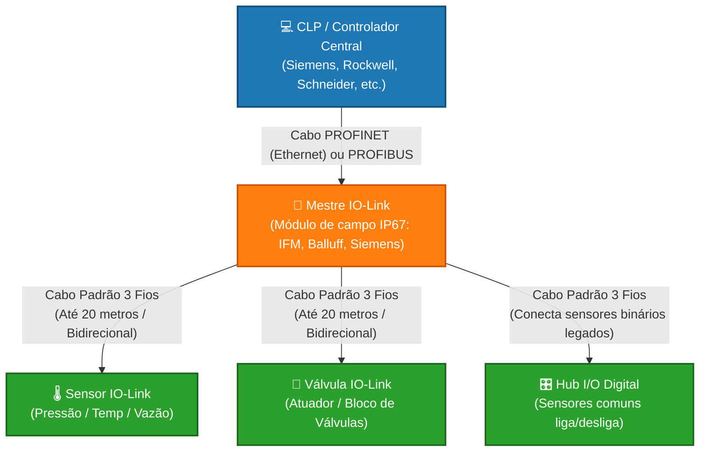

## 1 - Caracterização do protocolo: frequência de trabalho, acesso ao meio (colisão), aplicação/uso
A relação entre PROFINET, PROFIBUS e IO-Link representa a estrutura moderna de pirâmide de automação industrial. Eles não competem entre si; pelo contrário, trabalham juntos para conectar desde a sala de controle até o sensor mais simples na ponta do processo.

1. PROFINET (Nível de Rede Principal / Ethernet): É uma rede baseada em Ethernet Industrial de alta velocidade (≥ 100 Mbit/s). Ela conecta os controladores principais (CLPs) aos módulos de campo, inversores de frequência e Mestres IO-Link.

2. PROFIBUS (Rede de Campo Legada / Serial): É o predecessor do PROFINET, baseado em comunicação serial (RS-485). Embora esteja sendo substituído pelo PROFINET em novas instalações, ainda é amplamente integrado através de proxies ou gateways (como o IE/PB Link) para conversar com redes modernas.

3. IO-Link (Nível de Dispositivo / Ponta): Não é um barramento de rede (fieldbus), mas sim uma conexão ponto a ponto padronizada (IEC 61131-9) de curto alcance (até 20 metros). Ele transforma sensores e atuadores comuns em dispositivos "inteligentes", permitindo enviar múltiplos dados (diagnósticos, temperatura, configuração) através de um cabo comum de 3 fios não blindado

## 2 - Relação com a pirâmide de automação e indústria 4.0
## 3 - Limites
- Capacidade máxima: números de nós, taxa máxima de transmissão
## 4 - Topologias (Física e lógica)
## 5 - Meios de transmissão: característica física, tipo de cabeamento ou radio/frequência.
## 6 - Compatibilidade - equipamentos, outros protocolos
## 7 - 2 Exemplos (de programação em clp e de uso em supervisórios)