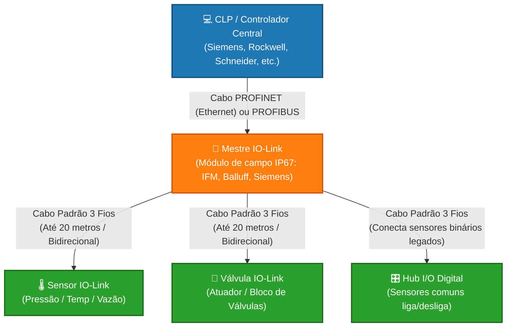
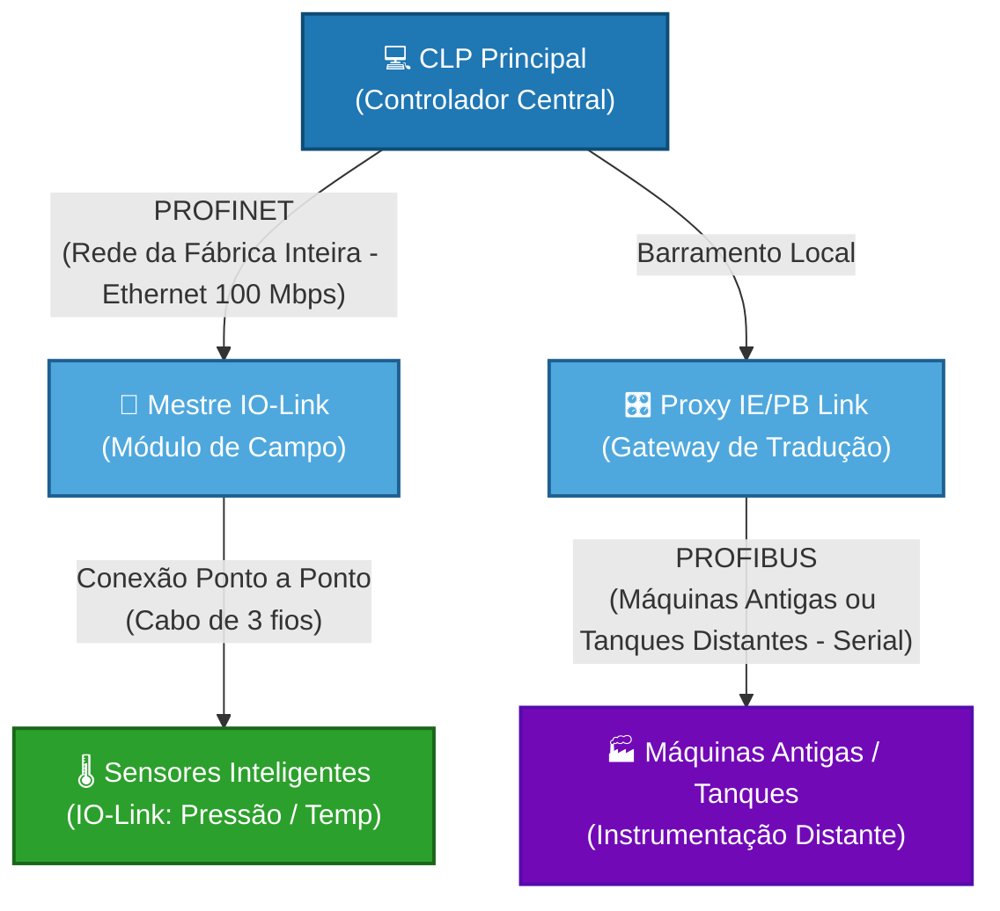

## 1 - Caracterização do protocolo: frequência de trabalho, acesso ao meio (colisão), aplicação/uso
A relação entre PROFINET, PROFIBUS e IO-Link representa a estrutura moderna de pirâmide de automação industrial. Eles não competem entre si; pelo contrário, trabalham juntos para conectar desde a sala de controle até o sensor mais simples na ponta do processo.

1. PROFINET (Nível de Rede Principal / Ethernet): É uma rede baseada em Ethernet Industrial de alta velocidade (≥ 100 Mbit/s). Ela conecta os controladores principais (CLPs) aos módulos de campo, inversores de frequência e Mestres IO-Link.

2. PROFIBUS (Rede de Campo Legada / Serial): É o predecessor do PROFINET, baseado em comunicação serial (RS-485). Embora esteja sendo substituído pelo PROFINET em novas instalações, ainda é amplamente integrado através de proxies ou gateways (como o IE/PB Link) para conversar com redes modernas.

3. IO-Link (Nível de Dispositivo / Ponta): Não é um barramento de rede (fieldbus), mas sim uma conexão ponto a ponto padronizada (IEC 61131-9) de curto alcance (até 20 metros). Ele transforma sensores e atuadores comuns em dispositivos "inteligentes", permitindo enviar múltiplos dados (diagnósticos, temperatura, configuração) através de um cabo comum de 3 fios não blindado

### frequencia de trabalho

1. Se a rede for PROFIBUS (DP)

No PROFIBUS, a frequência de trabalho é chamada de Baud Rate (Taxa de Bits). Ela define a velocidade física com que os pulsos elétricos viajam pelo cabo roxo.
• Velocidades configuráveis: Varia de 9,6 kbps até 12 Mbps.
• O detalhe crucial: No PROFIBUS, quanto maior a frequência/velocidade da rede, menor deve ser o comprimento do cabo. Por exemplo, a 1.5 Mbps o cabo pode ter até 200 metros, mas se você subir para 12 Mbps, o comprimento máximo do cabo cai para 100 metros.

2. Se a rede for PROFINET

Como o PROFINET roda sob a estrutura do Ethernet Industrial (cabo de rede padrão), a velocidade de transmissão física é fixa e padrão: 100 Mbps (ou 1 Gbps em redes de altíssima performance).
Por isso, no PROFINET, quando se fala em frequência de trabalho, os manuais geralmente se referem à Frequência de Atualização (Send Clock / Update Time):
• É o intervalo de tempo em que o CLP envia e recebe pacotes de dados de cada dispositivo.
• É medida em milissegundos ou microssegundos (ex: uma frequência de ciclo de 1 ms, 2 ms ou em alta performance/IRT chegando a 250 µs. 

3. Frequência (Velocidade) de Comunicação IO-Link

Na maioria das vezes, os manuais técnicos usam esse termo para indicar a taxa de transmissão de dados (Baud Rate) entre o mestre e o sensor. O padrão IO-Link (IEC 61131-9) define estritamente três frequências de trabalho possíveis (chamadas de canais COM):
• COM1: 4,8 kbps (frequência mais lenta, usada em dispositivos legados ou muito simples).
• COM2: 38,4 kbps (frequência média, muito comum em sensores de pressão e temperatura).
• COM3: 230,4 kbps (frequência mais alta, usada em dispositivos modernos que enviam muitos dados, como leitores de código de barras ou sensores de vazão complexos).
O que isso muda na prática? Quanto maior a frequência (COM3), mais rápido o CLP recebe as atualizações do sensor (menor é o tempo de ciclo, chegando a menos de 2 milissegundos). Os Mestres IO-Link modernos detectam e se ajustam a essa frequência automaticamente.

### Acesso ao meio

1. PROFIBUS: Token Passing e Mestre/Escravo (Híbrido)

O PROFIBUS (baseado na norma RS-485) utiliza uma combinação de dois métodos clássicos de acesso ao meio:
• Mestre/Escravo (Master/Slave): Os mestres (CLPs) mandam na rede. Um escravo (como uma remota de I/O) nunca fala por iniciativa própria. Ele fica em silêncio esperando o mestre fazer uma pergunta direta ("Você tem dados novos?"). Quando perguntado, o escravo responde imediatamente e volta a se calar.
• Passagem de Bastão (Token Passing): Se houver mais de um mestre na rede (por exemplo, dois CLPs ou um CLP e uma tela IHM), eles passam um arquivo virtual chamado "Token" (bastão) de um para o outro. Quem estiver com o Token tem o direito de controlar a rede e conversar com seus escravos por um tempo determinado. Quando o tempo acaba, ele passa o Token para o próximo mestre.

2. PROFINET: Full-Duplex e Comutação por Switches (Sem Colisão)

O PROFINET, por ser baseado em Ethernet Industrial, abandonou os métodos antigos de disputa por cabo (como o CSMA/CD do Ethernet doméstico antigo).
• Acesso Direto e Dedicado (Full-Duplex): O PROFINET exige o uso de cabos de 4 ou 8 fios e conexões através de Switches Industriais. Isso significa que cada dispositivo tem um canal físico exclusivo para enviar e outro para receber dados ao mesmo tempo (Full-Duplex).
• Divisão por Classes de Tráfego: No PROFINET, o acesso ao meio é controlado pelo Switch e pelo processador de rede através de prioridades:
	• PROFINET RT (Real-Time): Ignora as camadas pesadas do protocolo de internet (TCP/IP) e envia o dado direto da camada de aplicação para a camada física, garantindo prioridade máxima no Switch.
	• PROFINET IRT (Isochronous Real-Time): Divide o tempo de rede rigidamente em "janelas de tempo". Uma janela é guardada exclusivamente para os dados críticos de sincronismo e movimento (motores), e outra janela de tempo livre é aberta para dados comuns (como páginas web ou diagnósticos de TI).

3. IO-Link: Mestre/Escravo Puro (Ponto a Ponto)

No nível mais baixo, onde estão os sensores e atuadores, o acesso ao meio é o mais simples e robusto possível.
• Ponto a Ponto Exclusivo (Peer-to-Peer): Não há divisão de cabo com ninguém. Cada porta do Mestre IO-Link possui um único cabo conectado a um único sensor.
• Mestre/Escravo Estrito: O Mestre IO-Link dita o ritmo (ciclo de clock). Em intervalos de milissegundos muito precisos, o Mestre inicia a transmissão enviando uma solicitação ao sensor, e o sensor responde de volta no espaço de tempo alocado. Como é uma linha privada entre os dois, o risco de colisão é zero.

🏭 1. Aplicações com PROFINET + IO-Link (O Padrão Moderno)

É a combinação ideal para indústrias que exigem alta velocidade, flexibilidade, setup rápido e diagnósticos precisos.
• Indústria Automotiva e Linhas de Montagem:
	• Uso: Robôs de solda e braços mecânicos. O PROFINET gerencia os movimentos rápidos dos servo-motores em alta velocidade (via PROFINET IRT). Na ponta do robô, as garras usam Mestres IO-Link para coletar dados de múltiplos sensores de presença, pressão de ar e atuadores.
	• Vantagem prática: Se um sensor quebrar, o operador troca a peça fisicamente e o Mestre IO-Link baixa automaticamente a configuração antiga para o sensor novo, sem precisar de computador.
• Máquinas de Embalagem e Rotuladoras (Alimentos e Bebidas):
	• Uso: Sensores ópticos (fotoelétricos) IO-Link detectam a passagem de garrafas ou caixas em esteiras de alta velocidade.
	• Vantagem prática: Quando a fábrica muda o produto da linha (ex: de garrafa de 350ml para 2 litros), o CLP envia uma receita via PROFINET até o Mestre IO-Link, que reconfigura a sensibilidade e a distância de todos os sensores automaticamente, sem ninguém precisar ir ao chão de fábrica ajustar parafuso por parafuso.

🛢️ 2. Aplicações com PROFIBUS (Legados e Grandes Distâncias)

Embora o PROFINET domine as fábricas novas, o PROFIBUS (nas versões DP e PA) é massivamente utilizado em ambientes específicos.
• Saneamento, Tratamento de Água e Indústria Química (PROFIBUS PA):
	• Uso: Controle de grandes tanques, bombas e válvulas espalhados por quilômetros de distância. O PROFIBUS é usado aqui porque consegue cobrir distâncias elétricas longas (mais de 1 km) usando um único par de fios roxos.
	• Zonas Explosivas (Intrinsecamente Seguras): O PROFIBUS PA limita a energia elétrica no cabo para garantir que nenhuma faísca cause uma explosão em refinarias ou silos de grãos.
• Retrofit de Plantas Antigas (PROFIBUS DP):
	• Uso: Fábricas construídas entre os anos 1990 e 2010 possuem quilômetros de redes PROFIBUS rodando perfeitamente. Nesses locais, o uso do PROFIBUS continua para manutenção ou pequenas expansões.

🌉 3. O Uso Misto (Casamento das Três Tecnologias)

Em plantas industriais de grande porte (como Siderúrgicas ou Fábricas de Celulose), é muito comum ver as três tecnologias trabalhando juntas através de pontes de rede (Gateways ou Proxies).

• Como é usado: O coração da fábrica roda em PROFINET. Para conversar com um setor antigo ou com instrumentos de processo distantes, o sinal passa por um módulo acoplador (como o IE/PB Link da Siemens), traduzindo o sinal PROFINET para PROFIBUS sem que o CLP perca o controle.

## 2 - Relação com a pirâmide de automação e indústria 4.0
## 3 - Limites
- Capacidade máxima: números de nós, taxa máxima de transmissão
## 4 - Topologias (Física e lógica)
## 5 - Meios de transmissão: característica física, tipo de cabeamento ou radio/frequência.
## 6 - Compatibilidade - equipamentos, outros protocolos
## 7 - 2 Exemplos (de programação em clp e de uso em supervisórios)